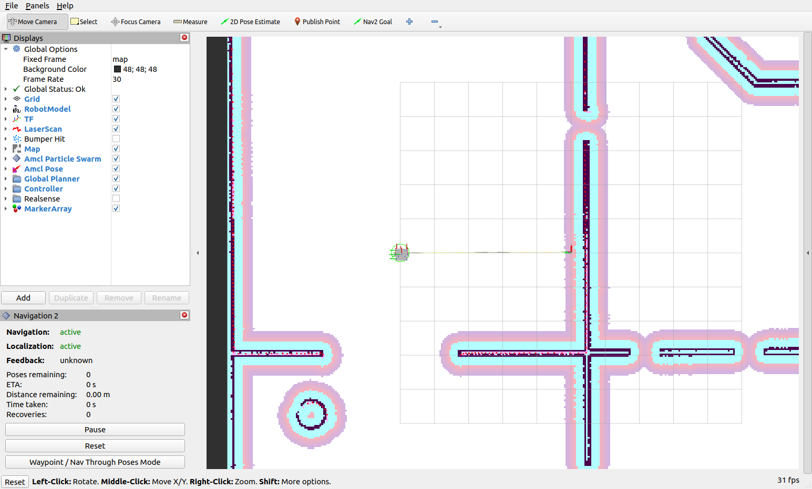
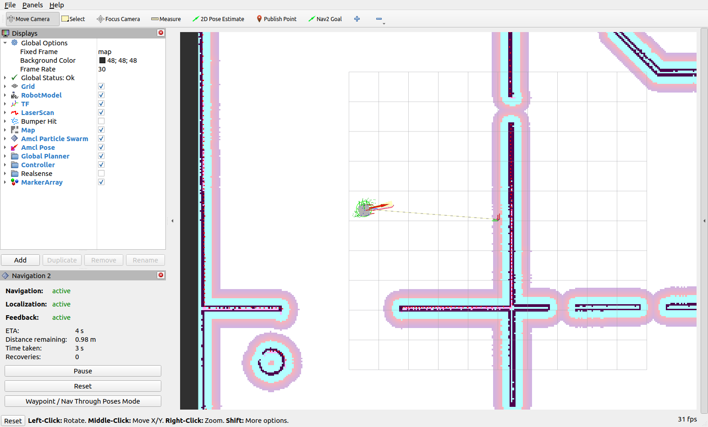

# Level 1: ROS 2 Navigation Assignment — ERIC Robotics

**Candidate / Engineer:** Ayush (GitHub: [@Droid-DevX](https://github.com/Droid-DevX))
**Development Branch:** `feature/ros-navigation`
**Target Environment:** ROS 2 Humble | Gazebo Classic 11.10.2 | Ubuntu 22.04 LTS

---

## 1. Executive Summary

This repository contains the complete implementation of the ERIC Robotics Level 1 ROS 2 Navigation Assignment for the **Testbed-T1.0.0** differential-drive mobile robot.

### Core Objectives Delivered:
1. **Repository Audit & Bug Resolution:** Identified, analyzed, and corrected 9 starter-code defects spanning build configuration, URDF modeling, sensor boundaries, map paths, kinematics, and clock synchronization (documented in [BUGS_FIXED.txt](./BUGS_FIXED.txt)).
2. **Modular Nav2 Stack (`testbed_navigation`):** Built a dedicated `ament_cmake` package strictly avoiding monolithic `nav2_bringup`. The navigation stack is partitioned into three independent, lifecycle-managed subsystems:
   - **Map Loader (`map_loader.launch.py`):** Loads and activates the 2D occupancy grid via `nav2_map_server`.
   - **Localization (`localization.launch.py`):** Probabilistic 2D pose estimation using `nav2_amcl` establishing the map -> odom TF link.
   - **Navigation (`navigation.launch.py`):** Manual instantiation and coordination of Planner Server (NavFn), Controller Server (DWB Local Planner), Behavior Server, BT Navigator, and Costmaps.
3. **System Verification:** Full end-to-end execution verified in Gazebo and RViz, achieving successful path planning, obstacle avoidance, and goal attainment (`SUCCEEDED`).

---

## 2. System & Robot Architecture

Complete specifications are detailed in [ROBOT_ARCHITECTURE.md](./docs/ROBOT_ARCHITECTURE.md).

### TF Transformation Hierarchy
```text
map
 └── odom                      [Broadcast by: nav2_amcl]
      └── base_footprint       [Broadcast by: libgazebo_ros_diff_drive]
           ├── base_link       [Broadcast by: robot_state_publisher via fixed_base_joint]
           │    ├── caster_1..4 [Static links]
           │    ├── dummy_link_1
           │    ├── imu_link_1
           │    └── lidar_link_1 [LaserScan sensor link: (-0.04, -0.04, 0.228)]
           ├── left_wheel_1    [Actuated joint]
           └── right_wheel_1   [Actuated joint]
```

### Key Topics & Sensor Interfaces
| Subsystem | Topic | Message Type | Purpose |
| :--- | :--- | :--- | :--- |
| **LaserScan** | `/scan` | `sensor_msgs/msg/LaserScan` | 360° LiDAR, 30 Hz, range: 0.1 m – 10.0 m |
| **Odometry** | `/odom` | `nav_msgs/msg/Odometry` | Wheel odometry at 100 Hz from diff-drive plugin |
| **Velocity Commands** | `/cmd_vel` | `geometry_msgs/msg/Twist` | Velocity commands to wheels |
| **Map** | `/map` | `nav_msgs/msg/OccupancyGrid` | 405 × 400 cells @ 0.05 m/cell |
| **AMCL Pose** | `/amcl_pose` | `geometry_msgs/msg/PoseWithCovarianceStamped` | Robot pose with covariance in map frame |
| **Navigation Action** | `/navigate_to_pose` | `nav2_msgs/action/NavigateToPose` | Goal action interface for path navigation |

---

## 3. Starter-Code Defects Identified and Fixed

Full descriptions and technical justifications are recorded in [BUGS_FIXED.txt](./BUGS_FIXED.txt):

1. **`testbed_description/CMakeLists.txt`:** Corrected syntax error `ament_package` -> `ament_package()`.
2. **`testbed_bringup/maps/testbed_world.yaml`:** Corrected image path `wrong_path_testbed_world.pgm` -> `testbed_world.pgm`.
3. **`testbed_bringup/CMakeLists.txt`:** Added `maps` directory to CMake install target.
4. **`testbed_gazebo/CMakeLists.txt`:** Added `models` directory to CMake install target.
5. **`testbed_description/urdf/testbed.gazebo`:** Fixed malformed IMU XML tag containing duplicate closing angle bracket.
6. **`testbed_description/urdf/testbed.gazebo`:** Removed obsolete ROS 1 `libgazebo_ros_control.so` plugin. Actuation is natively handled by `libgazebo_ros_diff_drive.so`.
7. **`testbed_description/urdf/testbed.gazebo`:** Increased LiDAR `<max>` range from `1.5` m to `10.0` m (room obstacles from spawn are 3.32 m away).
8. **`testbed_description/launch/robot_description.launch.py`:** Added `use_sim_time: True` to `robot_state_publisher` to synchronize TF timestamps with `/clock`.
9. **`testbed_description/urdf/testbed.gazebo`:** Corrected differential drive `<wheel_separation>` parameter from `0.35` m to `0.346` m to match actual URDF wheel joint origins.

---

## 4. Repository Structure

```text
level01_ros_assignment/
├── testbed_bringup/               # Robot bringup launch files and environment maps
│   ├── launch/
│   │   └── testbed_full_bringup.launch.py
│   └── maps/
│       ├── testbed_world.pgm
│       └── testbed_world.yaml
├── testbed_description/           # Robot URDF/Xacro, meshes, and RViz configurations
│   ├── launch/
│   ├── meshes/
│   ├── rviz/
│   └── urdf/
├── testbed_gazebo/                # Simulation world files and spawn scripts
│   ├── launch/
│   ├── models/
│   └── worlds/
├── testbed_navigation/            # [NEW] Modular ROS 2 Nav2 Navigation Package
│   ├── config/
│   │   ├── amcl_params.yaml       # Tuned AMCL parameters (DifferentialMotionModel, frames, initial pose)
│   │   ├── nav2_params.yaml       # NavFn planner, DWB controller, costmaps, and behavior tree configs
│   │   └── waypoints.yaml         # Semantic room waypoints and natural language aliases
│   ├── launch/
│   │   ├── map_loader.launch.py   # Independent Map Server + Lifecycle Manager
│   │   ├── localization.launch.py # Independent AMCL Localization + Lifecycle Manager
│   │   ├── navigation.launch.py   # Independent manual Nav2 node instantiation
│   │   └── testbed_navigation.launch.py # Unified demonstration launch
│   ├── scripts/
│   │   └── move_to.py             # Semantic navigation client CLI
│   ├── CMakeLists.txt
│   ├── package.xml
│   └── README.md
├── docs/
│   ├── media/                     # Visualization and demonstration screenshots
│   │   ├── amcl_localization.png
│   │   └── navigation_path_costmap.png
│   └── ROBOT_ARCHITECTURE.md      # Technical specifications and TF breakdown
├── move_to                        # CLI shortcut for semantic navigation
├── BUGS_FIXED.txt                 # Detailed defect analysis and fixes
├── help.md                        # Assignment FAQs and guidelines
└── README.md                      # Primary project documentation
```

---

## 5. Build & Installation Instructions

### Prerequisites
- Ubuntu 22.04 LTS
- ROS 2 Humble Desktop
- Gazebo Classic 11.10.2
- Nav2 Humble binaries:
  ```bash
  sudo apt update
  sudo apt install ros-humble-navigation2 ros-humble-nav2-bringup
  ```

### Build Workspace
```bash
cd ~/Robotics/level01_ros_assignment
source /opt/ros/humble/setup.bash
colcon build --symlink-install
source install/setup.bash
```

---

## 6. Execution Instructions (Step-by-Step Modular Workflow)

The assignment requires independent verification of each subsystem. Open separate terminals:

### Step 1: Launch Gazebo Simulation & Robot
```bash
source install/setup.bash
ros2 launch testbed_bringup testbed_full_bringup.launch.py
```
*Verification:* Gazebo opens with `testbed_playground.world`, the robot spawns at (0.0, 5.0, 0.0), and RViz launches.

### Step 2: Launch Independent Map Server
```bash
source install/setup.bash
ros2 launch testbed_navigation map_loader.launch.py
```
*Verification:*
```bash
ros2 topic echo /map --once
ros2 lifecycle get /map_server # returns: active [3]
```

### Step 3: Launch Independent AMCL Localization
```bash
source install/setup.bash
ros2 launch testbed_navigation localization.launch.py
```
*Verification:*
```bash
ros2 topic echo /amcl_pose --once
ros2 run tf2_ros tf2_echo map odom
```

### Step 4: Launch Manual Nav2 Navigation Stack
```bash
source install/setup.bash
ros2 launch testbed_navigation navigation.launch.py
```
*Verification:*
```bash
ros2 action list # shows /navigate_to_pose, /compute_path_to_pose, etc.
```

### Step 5: Send Autonomous Navigation Goal
You can send a goal interactively via the **2D Goal Pose** tool in RViz, via raw action CLI, or using the semantic room command:

**Option A — Semantic Room Command (Recommended):**
```bash
./move_to "living room"
./move_to "hallway"
./move_to "kitchen"
./move_to "bathroom"
./move_to "bedroom"
./move_to "dining room"
./move_to "home"
```
Or via ROS 2 CLI:
```bash
ros2 run testbed_navigation move_to living_room
ros2 run testbed_navigation move_to kitchen
ros2 run testbed_navigation move_to bathroom
```
To list all defined rooms, actual coordinates, and aliases:
```bash
./move_to --list
```

**Option B — Raw Action Goal:**
```bash
ros2 action send_goal /navigate_to_pose nav2_msgs/action/NavigateToPose \
  "{pose: {header: {frame_id: 'map'}, pose: {position: {x: 2.0, y: 5.0, z: 0.0}, orientation: {w: 1.0}}}}"
```

---

## 7. Unified Launch (Optional Demonstration)

For rapid demonstration, the three modular subsystems can also be brought up together using the convenience launch file:
```bash
# Terminal 1: Simulation
ros2 launch testbed_bringup testbed_full_bringup.launch.py

# Terminal 2: Complete Navigation Stack
ros2 launch testbed_navigation testbed_navigation.launch.py
```

---

## 8. Verification & Test Results

| Subsystem | Test Command | Outcome |
| :--- | :--- | :--- |
| **Build System** | `colcon build --symlink-install` | **PASSED** (4/4 packages built cleanly with 0 errors) |
| **Gazebo Spawning** | `ros2 topic list` | **PASSED** (Entity spawned, `/scan`, `/odom`, `/tf` live) |
| **LiDAR Sensor** | `ros2 topic echo /scan --once` | **PASSED** (360 deg FOV, obstacle ranges 3.4 m - 9.8 m) |
| **Odometry** | `ros2 topic echo /odom --once` | **PASSED** (100 Hz differential drive odometry) |
| **Map Server** | `ros2 lifecycle get /map_server` | **PASSED** (State: `active [3]`, `/map` 405x400 published) |
| **AMCL** | `ros2 lifecycle get /amcl` | **PASSED** (State: `active [3]`, `/amcl_pose` published) |
| **TF Map -> Odom** | `ros2 run tf2_ros tf2_echo map odom` | **PASSED** (Continuous localization transform broadcast) |
| **Navigation Lifecycle** | `ros2 lifecycle get /controller_server` | **PASSED** (All 4 nav servers `active [3]`) |
| **Autonomous Navigation** | Action goal to (2.0, 5.0, 0.0) | **PASSED** (`Goal finished with status: SUCCEEDED`) |

### Visual Verification & Demonstration Artifacts

#### 1. AMCL Localization & Particle Cloud
*Robot localized in Gazebo testbed playground with 2D occupancy grid, AMCL pose arrow, and particle filter cloud (`Global Status: Ok`, `Localization: active`):*


#### 2. Autonomous Navigation (Global Plan & Local Costmap)
*Autonomous navigation execution showing global path, local costmap obstacle inflation, and active navigation controller feedback:*


---

## 9. Troubleshooting & Engineering Notes

- **Initial Pose Behavior:** AMCL is preconfigured in `amcl_params.yaml` with the default spawn coordinates (x=0.0, y=5.0, yaw=0.0), so localization initializes automatically upon startup. You may also click **2D Pose Estimate** in RViz at any time.
- **Clock Synchronization:** All nodes and costmaps are strictly configured with `use_sim_time: True` to ensure deterministic execution matching Gazebo's physics time.
- **RMW Middleware:** Fast DDS operates stably with the current setup. If network UDP packet loss or discovery timeouts occur, switch to Cyclone DDS as advised in `help.md`:
  ```bash
  sudo apt install ros-humble-rmw-cyclonedds-cpp
  export RMW_IMPLEMENTATION=rmw_cyclonedds_cpp
  ```

---

## 10. Contact Info
- **Name:** Ayush
- **GitHub:** [https://github.com/Droid-DevX](https://github.com/Droid-DevX)
- **Repository Fork:** [https://github.com/Droid-DevX/level01_ros_assignment](https://github.com/Droid-DevX/level01_ros_assignment)
- **Branch:** `feature/ros-navigation`
